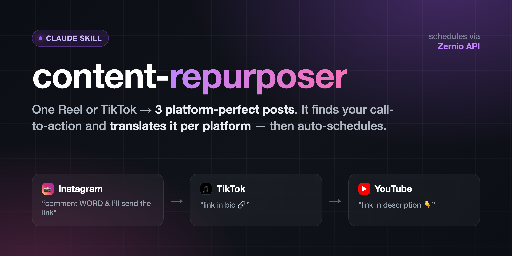

# content-repurposer



A Claude skill that turns **one** short-form video (an Instagram Reel or a TikTok)
into platform-correct versions for **Instagram, TikTok, and YouTube** — then
**auto-schedules TikTok + YouTube** through your own [Zernio](https://zernio.com)
account.

The hard part of cross-posting isn't the format (they're all 9:16) — it's the
**call-to-action**. "Comment WORD and I'll send the link" is right for Instagram
(DMs are the mechanic) but means nothing on TikTok or YouTube, where the link lives
in the bio / description. This skill detects the CTA (it transcribes the audio
**and** OCRs the frames) and **translates** it per platform — on the video and in
the caption — then schedules the result.

> Your original video file is never modified. Every output is a new file.

## What it does
1. **Setup (once)** — installs the free local tools and walks you through Zernio.
2. **Analyze** — finds the CTA: spoken, on-screen text, or description-only.
3. **Translate** — Instagram → "comment X and I'll send the link"; TikTok → "link
   in bio"; YouTube → "link in description". Edits the video where needed.
4. **Caption** — writes a caption per platform (YouTube gets a title + description).
5. **Schedule** — uploads and schedules TikTok + YouTube via Zernio. Instagram is
   manual by default (or automatic if you connect it on a paid Zernio plan).

## Install
1. **Clone into your Claude skills folder:**
   ```bash
   git clone <THIS_REPO_URL> ~/.claude/skills/content-repurposer
   ```
   (Or copy the `content-repurposer/` folder there.)
2. **First run does the rest.** Ask Claude to *"repurpose this video for TikTok and
   YouTube and schedule it,"* and the skill auto-runs setup:
   - `bash scripts/setup.sh` installs `ffmpeg`, `tesseract`, `faster-whisper`,
     `Pillow` (all free/local) and creates `.env`.
   - It walks you through connecting **TikTok + YouTube** in Zernio (first 2
     accounts free) and pasting your API key into `.env`.
   - It writes your personal `repurpose-config.md`.

   Prefer to set up by hand first? See [`references/setup-guide.md`](references/setup-guide.md)
   and [`references/zernio-setup.md`](references/zernio-setup.md).

## Requirements
- Python 3.9+
- A Zernio account (free tier covers TikTok + YouTube)
- macOS / Linux / Windows (WSL recommended on Windows)

## Configure
Everything you'd want to change lives in **`repurpose-config.md`** (your link, the
comment trigger word, post times, timezone, TikTok privacy, YouTube visibility,
whether Instagram is connected). Edit it in plain English anytime — no code changes.
Your Zernio key lives in `.env` (gitignored — never committed).

## Layout
```
content-repurposer/
├── SKILL.md                 # the skill instructions Claude follows
├── scripts/
│   ├── setup.sh             # one-time installer + verifier
│   ├── repurpose.py         # transcribe + spoken-CTA detect/trim
│   ├── scan_text_cta.py     # OCR on-screen CTA detection
│   ├── cover_cta.py         # cover + replace an on-screen CTA card
│   └── schedule_zernio.py   # upload + schedule via the Zernio API
├── references/              # caption patterns, Zernio + manual setup guides
└── assets/                  # config template + example scheduling job
```

## Privacy & cost
Transcription and all video edits run **locally** — no API, no key, no cost.
Nothing leaves your machine until you schedule a post. Zernio is the only external
service, and its first 2 connected accounts are free.

## License
MIT
